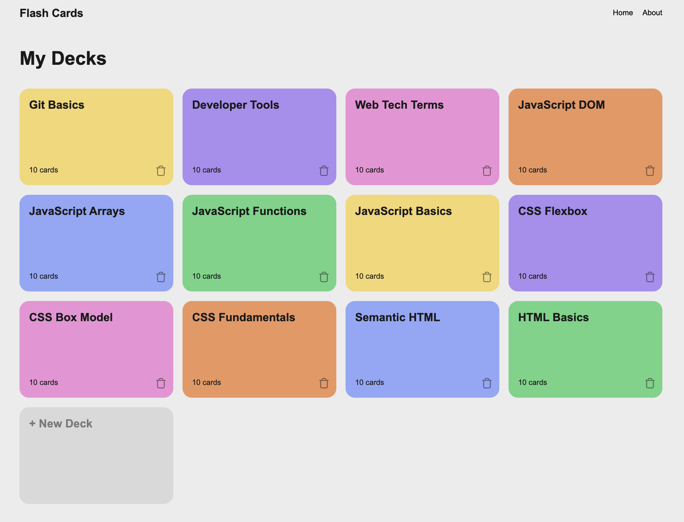
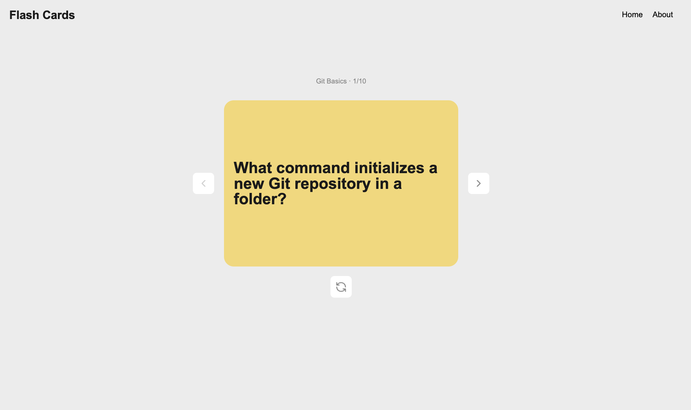
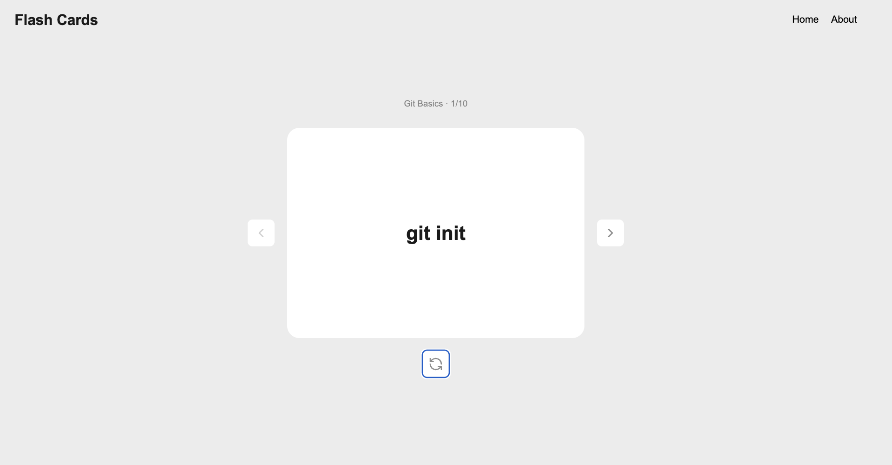

# Flashcard App

This is my first project in TripleTen's AI-Assisted Software Engineering program.

The app has several flashcard decks. Users can open a deck, move between cards, and flip each card to see the answer.

## Features

- View flashcard decks
- Open a deck
- Move between cards
- Flip cards to see the answers
- Delete decks
- Navigate between pages

## Technologies

- HTML
- CSS
- JavaScript

## How to Run

1. Download the project.
2. Open the project folder in VS Code.
3. Open `index.html` with Live Server.

## Author

Valeriia Archakhova

.
.
.
